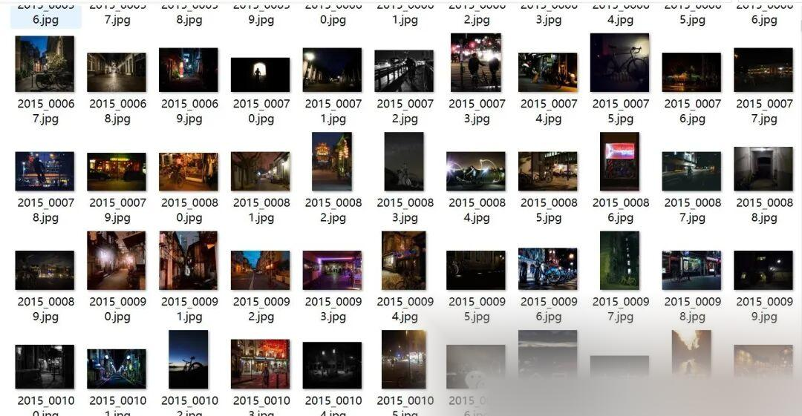
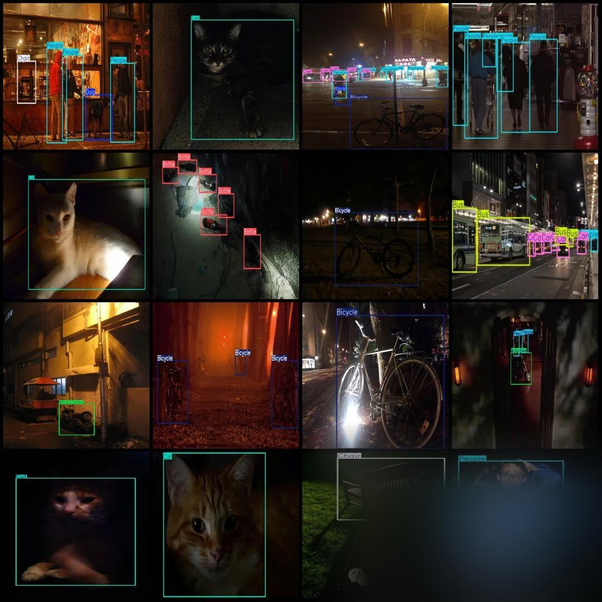

# EXdark detection dataset: VOC+YOLO format, 7363 images in 12 categories

Dataset format: Pascal VOC format + YOLO format (txt file without split path, only containing jpg images and corresponding VOC format xml files and yolo format txt files)

Number of images (number of jpg files): 7363

Number of annotations (number of xml files): 7363

Number of annotations (number of txt files): 7363

Label category count: 12

Label category names (Note that the order of categories in the YOLO format does not correspond to this, but is based on the labels folder's classes.txt): ["Bicycle", "Boat", "Bottle", "Bus", "Car", "Cat", "Chair", "Cup", "Dog", "Motorbike", "People", "Table"]

Number of boxes labeled in each category:

Bicycle frame count = 1120

Boat Frame Count = 1389

Bottle Frames = 1593

Bus frame count = 706

Car frame count = 2929

Cat Frames = 909

Chair Frame Count = 2377

Cup Frames = 1656

Dog Frames = 1018

Motorbike frame count = 1073

People Frames = 7461

Table Frames = 1483

Total frame count: 23714

Using labelImg:

Annotation rules: Draw a rectangle around the category.

Important Notice: No

Special : This dataset does not guarantee the accuracy or precision of the trained models or weight files. The dataset is provided with accurate and reasonable annotations only.

Image Preview:

Annotation example:

## Payment

Here is a pay link on Stripe ( https://buy.stripe.com/3cs8yP7sY87d0vu9AB ). Please contact me lonlonago@foxmail.com after funding $89, and I will send you a complete data files , thank you!

